_Matt_ delivers the news roundup.

## Headlines

### ViperIDE adds firmware flasher

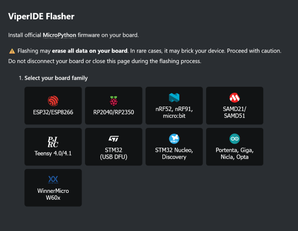

Volodymyr Shymanskyy
[shared](https://github.com/orgs/micropython/discussions/19748) that
[ViperIDE](https://viper-ide.org) can now flash your MicroPython firmware!
Chrome-based browsers only, but it's slick and effective. Along with the recent
addition of an MCP server, ViperIDE is becoming a powerful tool to have in the
kit!

### v1.30 scheduled for December 7th

There are already [82 PRs
merged](https://github.com/micropython/micropython/milestone/14?closed=1) with
[11 more in the open
state](https://github.com/micropython/micropython/milestone/14).

I suspect a few more will be added to the list before the end of November...

---

## Hardware news

### Kincony

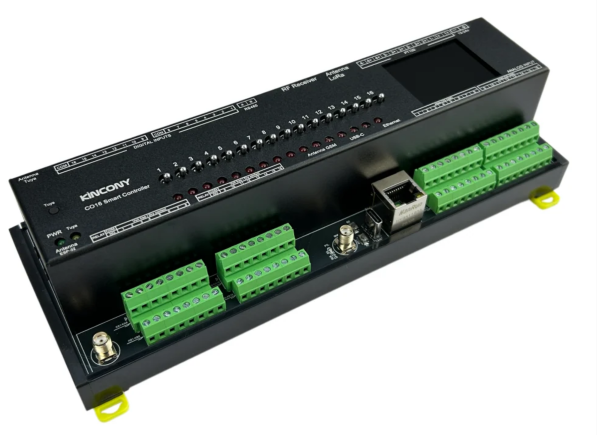

I only recently discovered the [Kincony](https://shop.kincony.com/) brand of
industrial-style devices. They seem aimed at supporting smart-home features but
there is a *large* number of devices in the lineup.

Of interest to us; while Kincony have official firmware for their devices, they
also encourage the use of Arduino and MicroPython. Since most of the devices
have an ESP32 at their heart, this is pretty easy!

They also have a decent [YouTube channel](https://www.youtube.com/@KinCony)
where you can get an idea of the features available.

I was lucky enough to borrow a colleague's [Kincony
CO16](https://shop.kincony.com/products/esp32-s3-16-channel-analog-input-smart-controller-co16)
and it now has a basic web interface to toggle onboard relays - and there are
drivers for all the peripherals. See
[kincony-co16-app](https://github.com/mattytrentini/kincony-co16-app) for
details.

If you're looking to improve your home automation - or generally interface to
devices - you might want to check out these devices. 

---

## Matts New Hardware

### Seeed XIAO STM32C5

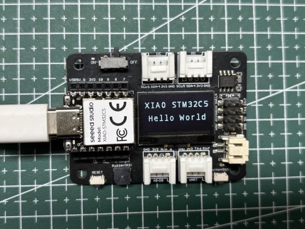

Officially launching November 5th (although [available for purchase
now](https://www.seeedstudio.com/XIAO-STM32C5-p-7011.html), shhh!), Seeed have
just added their first STM32 to their excellent XIAO range.

The [XIAO STM32C5](https://www.seeedstudio.com/XIAO-STM32C5-p-7011.html) is a
grunty little micro in that small XIAO form factor and they've packed a few
other features in to this one:

- STM32C5A3CG, Cortex-M33 @ 144MHz
- 256KB RAM, 1MB+16MB Flash
- Onboard CAN transceiver
- IMU
- Battery charging

There's already a detailed [Getting
Started](https://wiki.seeedstudio.com/xiao_stm32c5_getting_started) page.

I've also been spending time with [adding a C5
port](https://github.com/micropython/micropython/pull/19816), as it's a new
addition to the MicroPython stm32 port.  

**US$10**

---

### Waveshare RLCD with Nuno's firmware

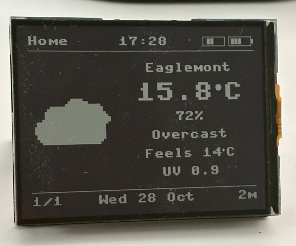

I covered the Waveshare RLCD last month, but thought I'd mention that it's
running Nuno Bispo's Weather Home Screen which looks pretty great!

Nuno has a detailed write-up on how he built it: [Building a Weather Home Screen on a Reflective LCD (MicroPython,
ESP32-S3)](https://developer-service.blog/building-a-weather-home-screen-on-a-reflective-lcd-micropython-esp32-s3/)

And the repo: [waveshare-rlcd-weather-article](https://github.com/nunombispo/waveshare-rlcd-weather-article)

---

## Software

### Game Boy Color on My Conference Badge

Steve Francia has an amazing blog post [Game Boy Color on My Conference
Badge](https://spf13.com/p/game-boy-color-on-my-conference-badge/) where he
explains how he created a Game Boy Color emulator in MicroPython! It runs on the
GitHub Universe badge - which is a slightly modified Pimoroni Tufty powered by
an RP2350. 

Just bring some cartridge ROMs, copy them to the filesystem and you're good to
go!

It's all open-source and can be found at
[universe-2026-badge-hacks](https://github.com/spf13/universe-2026-badge-hacks).

...

### Turning my GitHub Universe badge into an environmental monitor

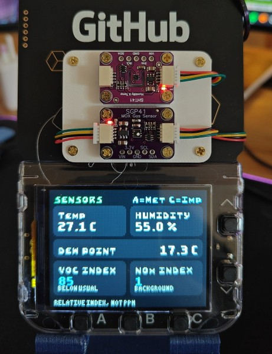

Speaking of the Github Universe badge, Wild Wanderer
[announced](https://bsky.app/profile/wildwanderer-vr.com/post/3mx5uj2i2vl2u)
that they published great writeup on how they added a couple of sensors to their
badge to create an environmental monitor:

[Turning my GitHub Universe badge into an environmental
monitor](https://blog.wildwanderer-vr.com/github-universe-badge-environment-sensors/)

In addition to these projects, it turns out the
[badger](https://github.com/badger/home/tree/main/badge/apps) repository
encourages folks to submit apps built for the GitHub Universe badge. There are a
*plethora* of apps to check out. 

---

### Babytalk

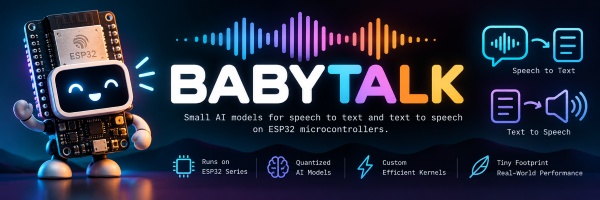

[Babytalk](https://github.com/tlack/babytalk) is a software library that lets an
ESP32-S3 or ESP32-P4 understand what you say and talk back, with no cloud and no
internet, from C, MicroPython, or Erlang/Elixir. They've shrunk down an Nvidia
model to do TTS and STT - and you still need 8MB RAM and 16MB flash - and are
using 16KHz audio. Still, I'm looking forward to seeing what the quality is
like!

---

### Sharp ZQ7790 Simulator - SHAM

<iframe width="560" height="315" src="https://www.youtube.com/embed/hhJmhNPXUHs?si=EC-9HgKrrLz8Rz9H" title="YouTube video player" frameborder="0" allow="accelerometer; autoplay; clipboard-write; encrypted-media; gyroscope; picture-in-picture; web-share" referrerpolicy="strict-origin-when-cross-origin" allowfullscreen></iframe>

Gadgetoid is at it again, taking on a *crazy* project...this one is a simulator
for the Sharp ZQ770, written in MicroPython. The ZQ770 is one of the earlier
examples of a personal organiser and so this scratches some nostalgic itches.
Gadgetoid has painstakingly recreated the look and feel of the original
organiser and simulated a good chunk of the software that ran on the original
device. 

Check out [sham](https://github.com/gadgetoid/sham) (Sharp Handheld
Approximation [MicroPython]).

---

### pixel framebuf

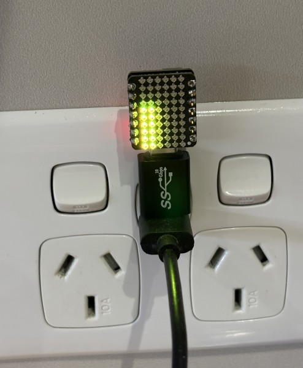

Based on a [similar CircuitPython
module](https://github.com/adafruit/Adafruit_CircuitPython_Pixel_Framebuf) (with
[great
documentation](https://learn.adafruit.com/easy-neopixel-graphics-with-the-circuitpython-pixel-framebuf-library)),
I've created
[micropython-pixel-framebuf](https://github.com/mattytrentini/micropython-pixel-framebuf).

It simply allows you to treat a panel of RGB LEDs as a
[FrameBuffer](https://docs.micropython.org/en/latest/library/framebuf.html) - so
you can use the drawing primitives in FrameBuffer but then render it on the RGB
LEDs.

(The above image is a small bar dispaly, rendered with
[`FrameBuffer.rect`](https://docs.micropython.org/en/latest/library/framebuf.html#framebuf.FrameBuffer.rect)
that reads a value in Home Assistant.)

---

### mpflipdot by Simon

<iframe width="560" height="315" src="https://www.youtube.com/embed/nHq_gT024Bs?si=6M4bWvHccUFDrFp3" title="YouTube video player" frameborder="0" allow="accelerometer; autoplay; clipboard-write; encrypted-media; gyroscope; picture-in-picture; web-share" referrerpolicy="strict-origin-when-cross-origin" allowfullscreen></iframe>

Friend of the meetup, Simon Prickett has a flipdot display and is not afraid to
use it! He created [mpflipdot](https://github.com/simonprickett/mpflipdot) so he could control it with MicroPython. 

There is something *special* about the sound of flipdots in action!

---

### Espressif ESP32 Chip Comparison Center

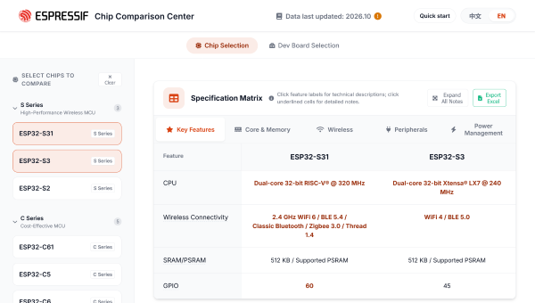

Espressif released a web tool that compares any of their various ESP32 micros.
As the popular microcontroller family has become larger and more complex, a few
of these comparison tools have appeared. But this one is *really* well
done...and official!

[ESP32 Chip Comparison
Center](https://docs.espressif.com/projects/esp-techpedia/en/latest/chip-comparator-web/ESP32_Chip_Comparator_Portable.html)

### Cyctlr

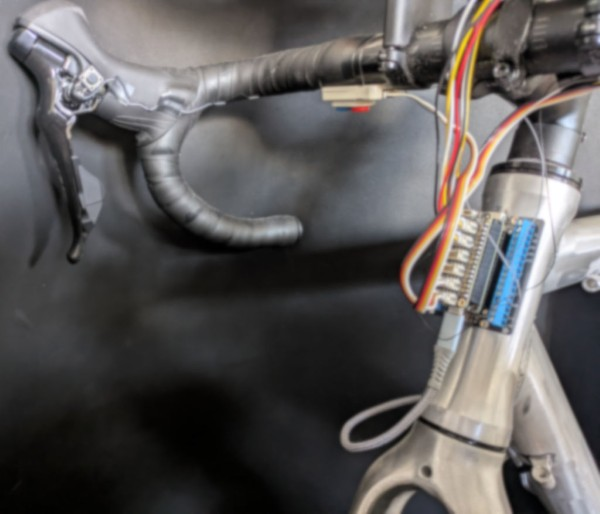

If you do any indoor cycling, this is the project for you.
[Cyctlr](https://codeberg.org/cyctlr/cyctlr-fw) is a collection of modules to
interface with hardware and allow you to do things while you ride on a trainer.
Play video games, control a headwind fan, implement a stopwatch or measure your
heart rate, there are a whole range of devices that have been integrated. Uses
MicroPython and BLE for most comms. 

---

### Mi-Hole

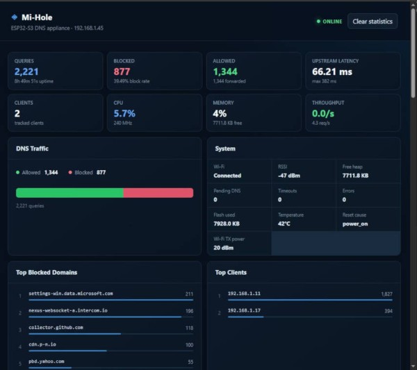

[Mi-Hole](https://github.com/rogerleuthner/public-mi-hole) is like
[Pi-hole](https://pi-hole.net/) but written in MicroPython, running on an ESP32.
That is to say it's a DNS filtering device that can block ads and other unwanted
network nasties.

It's *mostly* an educational tool, since an ESP32 doesn't quite have the network
throughput of a Linux SBC, but appears to be very functional.

---

### Python on my wrist

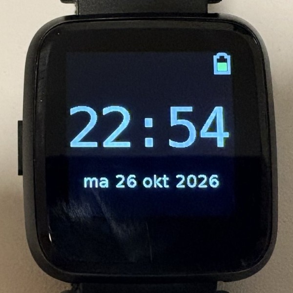

Michiel W Beijen [shared](https://fosstodon.org/@mwb/117511641875028523) that he
wrote a blog post - [Python on my
wrist](https://tildeweb.nl/~michiel/python-on-my-wrist.html) - on making his
PineTime run MicroPython. 

The best part was that he's pushed some PRs upstream and has been able to update
the MicroPython-based WaspOS so that it now runs from mainline. Open source done right!

### esp32sim

From the [esp32sim](https://github.com/mikroverk/esp32sim) README:

"esp32sim is an ESP32 emulator written in Rust. It runs real ESP32 firmware on
your computer or in a browser tab, without the hardware."

It can simulate the OG, S3, C3, C6. Even Wifi & BLE are simulated!

Best of all, there's an example showing how to run MicroPython on the simulator.

---

### M5Brick

<iframe width="560" height="315" src="https://www.youtube.com/embed/JLp3R0FNQuA?si=AD_GfHR1m-aFY6qS" title="YouTube video player" frameborder="0" allow="accelerometer; autoplay; clipboard-write; encrypted-media; gyroscope; picture-in-picture; web-share" referrerpolicy="strict-origin-when-cross-origin" allowfullscreen></iframe>

What do you get when you smoosh together LEGO and an M5Stack NanoC6?
[M5Brick](https://m5ware.com/projects/1306)!

Also revealed [M5Ware](https://m5ware.com/), a site with dozens of user projects
built with M5Stack devices. 

---

## Final Thoughts

Sam Neggs latest work has been awesome! He's been using LLMs to help build his graphical applications.

<iframe width="560" height="315" src="https://www.youtube.com/embed/4ujp8XDJiok?si=wyH13OR_HeGY8ZEU" title="YouTube video player" frameborder="0" allow="accelerometer; autoplay; clipboard-write; encrypted-media; gyroscope; picture-in-picture; web-share" referrerpolicy="strict-origin-when-cross-origin" allowfullscreen></iframe>

<iframe width="560" height="315" src="https://www.youtube.com/embed/bbW3knng5Bs?si=HOnMNP4C4HPFDQAw" title="YouTube video player" frameborder="0" allow="accelerometer; autoplay; clipboard-write; encrypted-media; gyroscope; picture-in-picture; web-share" referrerpolicy="strict-origin-when-cross-origin" allowfullscreen></iframe>

<iframe width="560" height="315" src="https://www.youtube.com/embed/XowodEERlyI?si=rWcmBu8nn9ixWkxV" title="YouTube video player" frameborder="0" allow="accelerometer; autoplay; clipboard-write; encrypted-media; gyroscope; picture-in-picture; web-share" referrerpolicy="strict-origin-when-cross-origin" allowfullscreen></iframe>

---

## Midjourney fun

